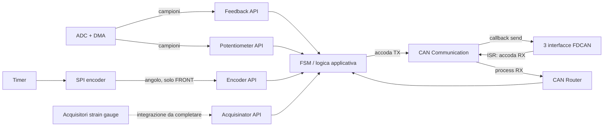
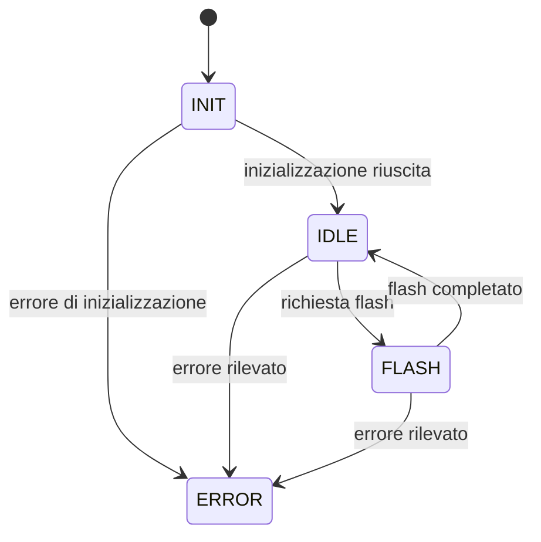

# DAS firmware

Firmware del **Data Acquisition System (DAS)**. La stessa codebase costruisce i nodi anteriore (`DAS_FRONT`) e posteriore (`DAS_REAR`): acquisisce i segnali locali, ne mantiene una rappresentazione applicativa e predispone lo scambio dati sulle tre reti CAN del veicolo.

Questo documento descrive il codice specifico del DAS. Si assume che il lettore conosca già STM32, HAL, DMA e interrupt; i file generati da CubeMX non vengono quindi trattati, salvo quando fanno da collegamento con i moduli applicativi.

## Architettura

Il firmware è diviso in tre livelli:

1. **Adattamento hardware** — le callback nei file periferici trasformano campioni ADC, dati SPI e frame FDCAN nei tipi usati dal DAS.
2. **Moduli applicativi** — i file in `Core/Inc/das` e `Core/Src/das` possiedono lo stato dei sensori e implementano comunicazione e logica di controllo.
3. **Orchestrazione** — `main.c` costruisce le dipendenze, avvia le acquisizioni e richiama ciclicamente la macchina a stati.



Le API dei sensori seguono tutte lo stesso schema: un handler statico conserva l'ultimo valore valido, le callback di acquisizione lo aggiornano tramite una funzione `set`, mentre il resto dell'applicazione lo legge tramite una funzione `get`. In questo modo la logica DAS non dipende direttamente dagli handle HAL.

## Varianti FRONT e REAR

Le varianti sono selezionate a compile time dagli environment PlatformIO:

| Variante | Simbolo | Funzioni specifiche |
| --- | --- | --- |
| Anteriore | `DAS_FRONT` | Feedback pilota, shutdown sinistro e destro, inerziale; encoder del volante |
| Posteriore | `DAS_REAR` | Feedback interlock e linea ARMS; nessun modulo encoder |

I moduli potenziometri, acquisitori, FSM e comunicazione CAN sono condivisi. `feedback.h` impedisce di compilare con entrambe le varianti abilitate contemporaneamente.

## Moduli applicativi

### Feedback

File: `feedback.h`, `feedback-api.h`, `feedback-api.c`; integrazione in `adc.c`.

Rappresenta le linee di feedback digitalizzate dal DAS. I campioni ADC vengono classificati come:

- `LOW` sotto la soglia inferiore;
- `HIGH` sopra la soglia superiore;
- `IMPLAUSIBILITY` nella zona intermedia;
- `ERROR` quando il valore non è disponibile o la richiesta non è valida.

Il numero e il significato delle linee dipendono dalla variante FRONT/REAR. All'inizializzazione ogni linea parte da `ERROR`; la callback di completamento ADC aggiorna poi lo stato conservato dal modulo.

### Potenziometri

File: `potentiometer.h`, `potentiometer-api.h`, `potentiometer-api.c`; integrazione in `adc.c`.

Conserva i valori ADC grezzi a 12 bit dei potenziometri sinistro e destro. L'API accetta valori da 0 a 4095 e restituisce `-1` per un identificatore non valido. Le conversioni continue via DMA aggiornano entrambi i canali attraverso la callback ADC.

### Encoder volante

File: `encoder.h`, `encoder-api.h`, `encoder-api.c`; integrazione in `spi.c` e `tim.c`.

È compilato solo per `DAS_FRONT`. Una lettura SPI di due byte viene convertita da formato a 12 bit in gradi nell'intervallo 0–360 e salvata come `float`. Il timer fornisce il punto di trigger per le letture periodiche e la callback SPI pubblica il nuovo angolo nell'API.

### Acquisitori strain gauge

File: `acquisinator.h`, `acquisinator-api.h`, `acquisinator-api.c`.

Modella sei acquisitori, ciascuno con una coppia di valori `float` provenienti da strain gauge. Il modulo offre inizializzazione e accesso allo stato in memoria; il collegamento alla sorgente fisica dei dati non è ancora presente nel ciclo applicativo.

### Comunicazione CAN

File: `can-communication.h`, `can-communication-api.h`, `can-communication-api.c`, `can-communication-router-api.h`, `can-communication-router-api.c`; adattamento hardware in `fdcan.c`.

Il modulo espone un'unica astrazione per tre reti fisiche:

| Rete logica | Adattatore hardware |
| --- | --- |
| `PRIMARY` | FDCAN1 |
| `SECONDARY` | FDCAN2 |
| `DAS` (rete privata) | FDCAN3 |

Ogni rete possiede una coda RX e una coda TX da 128 frame Classic CAN, con payload massimo di 8 byte. Le code sono implementate tramite `libpal` e allocate da un'arena condivisa.

Il flusso previsto è:

- **Ricezione:** la callback FDCAN traduce il frame HAL in `CanCommunicationFrame` e lo accoda; `can_communication_api_process_rx()` svuota la coda e invoca il router associato alla rete.
- **Trasmissione:** l'applicazione chiama `can_communication_api_add_to_tx()`; `can_communications_api_process_tx()` svuota la coda usando la callback hardware registrata durante l'inizializzazione.

I callback `cs_enter` e `cs_exit` permettono di proteggere le code condivise tra ISR e main loop. In `main.c` sono predisposti usando disabilitazione e riabilitazione degli interrupt.

Il router CAN è il punto destinato alla deserializzazione dei messaggi e all'aggiornamento dello stato applicativo. Al momento valida soltanto il puntatore al frame: il dispatch basato su ID e l'integrazione con la CAN library sono ancora TODO.

### Macchina a stati

File: `fsm.h`, `fsm.c`.

La FSM, generata con `gv_fsm`, definisce quattro stati:



`INIT` inizializza attualmente feedback e potenziometri. `IDLE`, `FLASH`, `ERROR` e le funzioni di transizione costituiscono lo scheletro della logica futura; non eseguono ancora operazioni applicative. `ERROR` non prevede una transizione di uscita.

## Avvio e ciclo applicativo

Dopo l'inizializzazione delle periferiche, `main.c`:

1. prepara per ciascuna rete CAN le callback di trasmissione, ricezione e sezione critica;
2. esegue una prima iterazione della FSM nello stato `INIT`;
3. avvia le acquisizioni DMA di feedback e potenziometri;
4. richiama continuamente `fsm_run_state()`.

### Stato di integrazione attuale

La struttura software è più avanti del wiring nel main loop. Prima di aggiungere nuova logica è importante sapere che:

- la configurazione CAN costruita in `main.c` viene passata alla FSM, ma `fsm_do_init()` non la usa ancora e non chiama `can_communication_api_init()`;
- il main loop non richiama ancora `can_communication_api_process_rx()` o `can_communications_api_process_tx()`;
- il router CAN non deserializza ancora i frame;
- acquisitori ed encoder dispongono delle rispettive API, ma la loro inizializzazione non è ancora inserita nella FSM;
- il trigger periodico dell'encoder è implementato, ma il timer non viene ancora avviato dal flusso applicativo;
- gli stati `IDLE` e `FLASH` non contengono ancora la logica operativa.

Questi punti sono estensioni previste, non responsabilità da duplicare in nuovi moduli.

## Dove intervenire

```text
Core/
├── Inc/das/       Tipi, contratti e API pubbliche del DAS
├── Src/das/       Stato e logica dei moduli applicativi
├── Inc/           Interfacce dell'adattamento hardware
└── Src/           Callback periferiche e composition root in main.c
test/              Unit test native delle API applicative
```

Per aggiungere una sorgente dati, mantenere la separazione esistente:

1. definire tipo di dato, nomi e codici di ritorno nell'header del modulo;
2. esporre l'API applicativa nel relativo `*-api.h`;
3. conservare lo stato nel modulo, senza esporre handle HAL;
4. tradurre i dati hardware nella callback periferica e aggiornare il modulo tramite la sua API;
5. consumare i dati nella FSM o nel router CAN;
6. aggiungere il test nativo dell'API sotto `test/`.

## Build e test

Il progetto usa PlatformIO e C23. Le dipendenze applicative (`libeagletrt` e `libpal`) vengono risolte dagli environment definiti in `platformio.ini`.

```sh
# Firmware DAS anteriore
pio run -e front

# Firmware DAS posteriore
pio run -e rear

# Unit test delle due varianti
pio test -e tests_front
pio test -e tests_rear

# Analisi statica dei moduli DAS
pio check -e front
pio check -e rear
```

I test native coprono le API di feedback, potenziometri, encoder, acquisitori e comunicazione CAN. L'encoder è escluso dalla suite REAR perché il relativo modulo non viene compilato in quella variante.
